### `gabriel@github ~ $ whoami`

<table>
  <tr>
    <td valign="top"></td>
    <td valign="top"></td>
  </tr>
</table>

### `gabriel@github ~ $ ./contributions.sh`

**`gabriel@github ~ $ cat stack.md`**

| Categoria            | Tecnologias                                              |
| -------------------- | -------------------------------------------------------- |
| **Linguagens**       | TypeScript, JavaScript, Java, Python, PHP, SQL           |
| **Frontend**         | React, Next.js, HTML, CSS                                |
| **Backend**          | Laravel, Spring Boot, Spring Data JPA, Node.js, Prisma   |
| **Automação**        | n8n, Webhooks, WhatsApp/Telegram                         |
| **Bancos de dados**  | MySQL                                                    |
| **IoT & Visão**      | ESP32, MQTT, ThingsBoard, Wokwi, YOLO, OpenCV            |
| **DevOps & Tooling** | Docker, Git, GitHub Actions, VS Code, Claude Code        |

**`gabriel@github ~ $ ls projects/`**

- **Notivy**: plataforma de agendamento que recebe compromissos por WhatsApp/Telegram e envia lembretes automáticos
- **Gym API**: API REST de gestão de academia em Spring Boot + JPA + MySQL
- **Waste Classifier**: classificação de resíduos em tempo real com Python + YOLO
- **ESP32 + ThingsBoard**: telemetria IoT via MQTT
